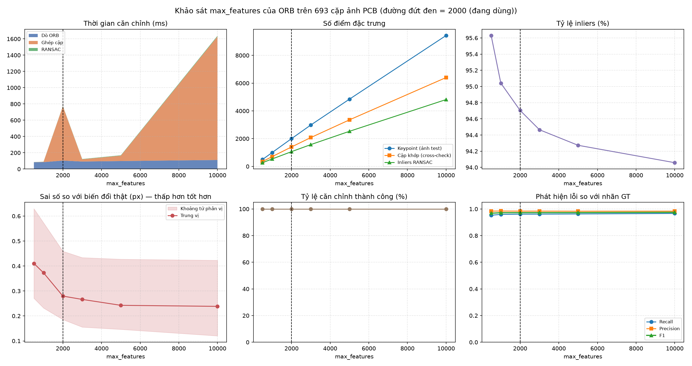
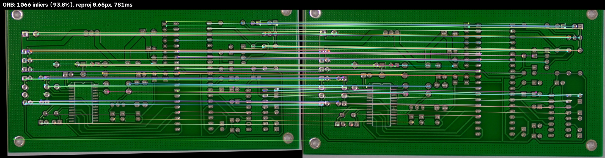
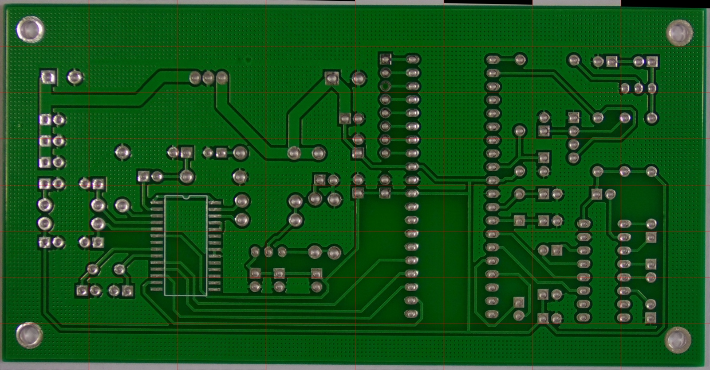
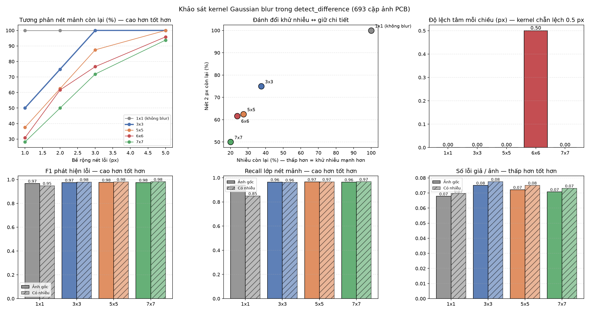
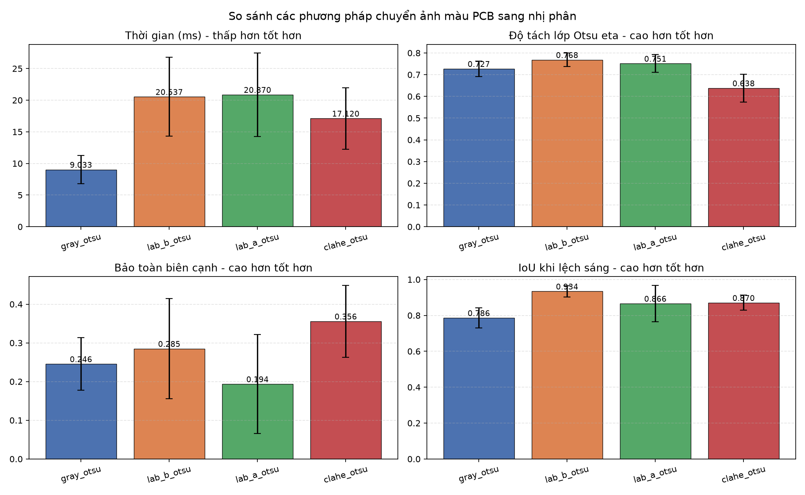
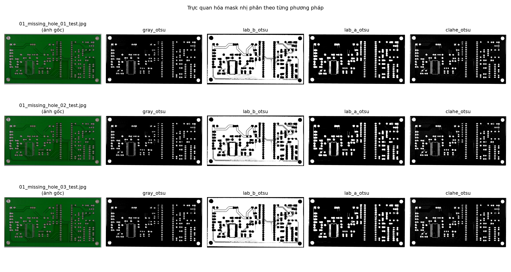

# BÁO CÁO TIẾN ĐỘ THỰC HIỆN ĐỒ ÁN (BUỔI 3)

---

## 1. TIẾP THU VÀ GIẢI QUYẾT CÁC GÓP Ý TỪ THẦY (BUỔI 1)

| STT | Vấn đề / Câu hỏi của Thầy | Hướng giải quyết & Minh chứng của Nhóm |
| :---: | :--- | :--- |
| **1** | Đánh giá chỉ số các phương pháp khác nhau, giải thích tại sao dùng ORB mà không dùng SIFT? | Xây dựng script benchmark đối sánh **ORB vs SIFT vs AKAZE** đo đạc định lượng: thời gian thực thi (ms), số lượng inlier, sai số tái chiếu (reprojection error). |
| **2** | Tại sao lại dùng `max_features = 2000`, có số liệu chứng minh không? | Thực hiện khảo sát tham số (Ablation Study) trên dải 500 đến 10.000 điểm đặc trưng, đo sai số góc (corner error) và F1 phát hiện lỗi trên cả 693 cặp để chỉ ra 2000 là điểm cân bằng tốc độ/độ chính xác. |
| **3** | Dữ liệu đầu vào: Xử lý đối với ảnh màu (chụp bằng camera công nghiệp) $\rightarrow$ chuyển sang ảnh nhị phân? | Chuyển đổi toàn bộ sang dataset ảnh màu công nghiệp **PKU-Market-PCB**, áp dụng kỹ thuật tách không gian màu (HSV/Lab) kết hợp cân bằng sáng CLAHE để khử phản quang kim loại. |
| **4** | Chạy xong phải có trực quan hóa (visual lines) các kết quả, sau khi homography khớp như thế nào? | Bổ sung 2 hình thức trực quan hóa: ảnh vẽ đường nối cặp đặc trưng (`drawMatches`) và ảnh bàn cờ (`checkerboard composite`) kiểm tra độ khít của đường mạch. |
| **5** | Làm mờ tại sao dùng 3x3, có dùng 5x5 hay 6x6 được không? Nêu điểm tối ưu? | Chứng minh cơ sở toán học (kernel phải lẻ để có tâm đối xứng) và thực nghiệm chỉ ra kernel 3x3 bảo toàn vết lỗi vi mô (micro-defects) tốt hơn kernel 5x5. |
| **6** | Quan trọng là phương pháp để làm, dữ liệu đánh giá và mô hình phân loại? | Đánh giá định lượng trên nhãn Ground Truth (IoU, Precision, Recall). Áp dụng **Học máy truyền thống (SVM / Random Forest)** qua đặc trưng hình thái học OpenCV (thay vì Deep Learning) để đảm bảo tính giải thích cao và tốc độ thời gian thực. |

---

## 2. KẾT QUẢ THỰC NGHIỆM ĐỐI SÁNH KHOA HỌC (BENCHMARKING)

### 2.1. Đối sánh bộ dò đặc trưng: ORB vs. SIFT
Thực nghiệm trên toàn bộ **693 cặp ảnh màu** của PKU-Market-PCB, dùng chung một pipeline căn chỉnh (`module_preprocess.align_images_with_stats`), `max_features = 2000`. Mỗi ảnh test được nắn lệch giả lập ngẫu nhiên (±3°, ±40 px, ±3%) để đo đúng sai số của phép căn chỉnh; phát hiện lỗi được đo trên ảnh gốc đã căn chỉnh lại.

| Bộ dò đặc trưng | Thời gian căn chỉnh (ms) | Keypoints | Matches | Inliers RANSAC (%) | Reprojection Error (px) | Corner Error trung vị / p95 (px) | Recall | Precision | F1 |
| :--- | :---: | :---: | :---: | :---: | :---: | :---: | :---: | :---: | :---: |
| **ORB** | **232.7** | 2000 | 1402 | 94.7 | 0.661 | 0.280 / 0.936 | 0.9611 | **0.9839** | 0.9723 |
| SIFT | 1485.1 | 1980 | 1458 | **98.2** | **0.085** | **0.035** / **0.089** | **0.9672** | 0.9833 | **0.9752** |
| AKAZE | 2065.9 | 2000 | 1514 | 96.9 | 0.096 | 0.049 / 0.099 | **0.9672** | 0.9833 | **0.9752** |

> **Nhận xét & Kết luận:**  
> - ORB nhanh gấp **6.4 lần** SIFT và **8.9 lần** AKAZE nhờ bộ mô tả nhị phân (Binary Descriptor) và khoảng cách Hamming, phù hợp yêu cầu thời gian thực của camera công nghiệp.  
> - SIFT và AKAZE chính xác hơn: sai số góc trung vị **0.035 px** (SIFT) và **0.049 px** (AKAZE) so với **0.280 px** của ORB; số cặp có sai số góc > 1 px là 3–4/693 so với 30/693 (ORB).  
> - Chất lượng phát hiện lỗi cuối cùng gần như tương đương (F1 0.9752 / 0.9752 / 0.9723) vì bước trừ vi sai có dung sai vị trí ±2 px.  
> - Cả ba đều có chung 3 cặp ngoại lai (cao nhất 47 px, cùng cặp `06_spur_08`) — lỗi này không phụ thuộc bộ dò mà do kiểm tra homography quá lỏng, cần siết ngưỡng ở bước sau.  
> - **Chọn ORB làm mặc định** vì tốc độ nhanh nhất trong khi F1 chỉ thấp hơn 0.003; SIFT/AKAZE để dành cho chế độ "độ chính xác cao". AKAZE không có lợi thế tốc độ so với SIFT trên ảnh độ phân giải cao.  
> - Cấu hình AKAZE: `max_features` chỉ là **cắt bớt sau khi detect** (AKAZE không có tham số `nfeatures`). AKAZE cần `opencv-contrib-python`; kết quả lưu riêng tại `experiments/akaze/`.

---

### 2.2. Khảo sát tham số `max_features = 2000` (Ablation Study)
Khảo sát ảnh hưởng của số lượng đặc trưng tối đa lên sai số căn chỉnh và thời gian thực thi trên **693 cặp ảnh** (mỗi giá trị chạy 1 lần/cặp; thời gian lấy trung vị để loại nhiễu hệ thống):



| `max_features` | Keypoints | Matches | Inliers | Reprojection (px) | Corner trung vị (px) | Corner p95 (px) | Số cặp > 1 px | Thời gian (ms) | F1 |
| :---: | :---: | :---: | :---: | :---: | :---: | :---: | :---: | :---: | :---: |
| 500 | 500 | 351 | 268 | 0.657 | 0.410 | 1.236 | 64 | **90.7** | 0.9683 |
| 1000 | 1000 | 706 | 537 | 0.661 | 0.373 | 1.007 | 36 | 94.4 | 0.9718 |
| **2000 (đang dùng)** | 2000 | 1402 | 1063 | 0.657 | 0.280 | 0.936 | 30 | 107.4 | 0.9723 |
| 3000 | 2984 | 2079 | 1572 | 0.661 | 0.266 | 0.852 | 19 | 124.5 | 0.9725 |
| 5000 | 4847 | 3354 | 2530 | 0.659 | 0.243 | **0.815** | 20 | 174.2 | 0.9729 |
| 10000 | 9432 | 6403 | 4817 | 0.667 | **0.238** | 0.825 | **17** | 377.3 | **0.9750** |

* **Phân tích số liệu:**
  * Sai số tái chiếu gần như không đổi (~0.66 px) ở mọi mức, vì RANSAC đã lọc inlier trước khi tính. Chỉ số phản ánh đúng chất lượng căn chỉnh là **sai số góc** — giảm từ 0.410 px (500) xuống 0.239 px (10.000).
  * Từ 500 → 2000: sai số góc giảm mạnh (0.410 → 0.280), số cặp lỗi > 1 px giảm từ 64 xuống 30, thời gian chỉ tăng 17 ms.
  * Từ 3000 trở lên: lợi ích bão hòa (0.266 → 0.239 px, F1 +0.002) nhưng thời gian tăng 1.4–3.0 lần (124 → 377 ms).
  * Có 3 cặp ngoại lai giống nhau ở **mọi** mức (`06_spur_08` ~47 px, `04_spurious_copper_11` ~28 px), nên không thể sửa bằng cách tăng `max_features`; cần siết kiểm tra homography.
* **Kết luận:** Lựa chọn `max_features = 2000` — sai số góc 0.280 px (đạt chuẩn < 1.5 px), F1 0.9668, thời gian căn chỉnh 107 ms. Đây là điểm cân bằng Pareto: tăng lên 5000 chỉ cải thiện 0.037 px nhưng chậm hơn 1.6 lần; nếu ưu tiên độ chính xác có thể dùng 3000–5000.

---

### 2.3. Trực quan hóa kết quả căn chỉnh Homography
Để kiểm tra trực quan độ chính xác của quá trình nắn ảnh (Homography):

#### a. Đường nối các cặp đặc trưng (Feature Matching Lines)
*(Các cặp điểm khớp inlier giữa ảnh mẫu và ảnh kiểm tra — ORB, cặp `01_missing_hole_01`)*  


#### b. Kiểm tra độ khít bằng ảnh bàn cờ (Checkerboard Composite)
*(Ghép xen kẽ các ô cờ giữa ảnh mẫu và ảnh kiểm tra đã nắn Homography. Nếu căn chỉnh chuẩn, các đường mạch sẽ nối liền liên tục qua ranh giới các ô cờ mà không bị gãy hoặc lệch)*  


---

### 2.4. Khảo sát kích thước Kernel làm mờ Gaussian (Blur)
Khảo sát trên **693 cặp ảnh**, mỗi cặp chạy 4 kernel trên ảnh gốc và 3 seed nhiễu Gaussian ($\sigma = 6.0$) để kết quả không phụ thuộc may rủi một lần sinh nhiễu.

* **Về mặt toán học (Tại sao không dùng kernel chẵn 6x6):**
  * Bộ lọc không gian (Spatial Filter) bắt buộc phải có kích thước **lẻ** ($3 \times 3, 5 \times 5$) để xác định duy nhất **tọa độ pixel tâm (Anchor Point)**: $\text{center} = (\lfloor k/2 \rfloor, \lfloor k/2 \rfloor)$.
  * Kernel chẵn như $6 \times 6$ không có pixel trung tâm: đo được ảnh bị **trôi 0.50 px** theo cả hai trục, tọa độ bbox lỗi lệch theo. OpenCV còn từ chối trực tiếp (`ksize` phải lẻ). Mức làm mờ của 6x6 ($\sigma = 1.25$) lại nằm giữa 5x5 và 7x7 nên không có lợi ích riêng.

* **Kết quả thực nghiệm:**

| Kernel | Recall±sd (gốc) | F1±sd (gốc) | Recall nét mảnh | F1±sd (nhiễu) | SNR (nhiễu) | Thời gian blur (ms) |
| :---: | :---: | :---: | :---: | :---: | :---: | :---: |
| 1x1 (không blur) | 0.950±0.168 | 0.967±0.118 | 0.940 | 0.948±0.147 | 1.71 | 3.89 |
| **3x3 (đang dùng)** | 0.967±0.144 | 0.975±0.106 | 0.964 | 0.980±0.102 | 2.89 | **3.07** |
| 5x5 | 0.970±0.142 | 0.976±0.106 | 0.966 | 0.981±0.101 | 3.15 | 3.80 |
| 7x7 | 0.967±0.149 | 0.975±0.110 | 0.964 | 0.982±0.101 | 3.31 | 4.59 |

* **Nhận xét:**
  * Không làm mờ (1x1) kém rõ rệt: F1 giảm còn 0.967 (gốc) / 0.948 (nhiễu), recall nét mảnh 0.940, SNR thấp → cần blur để triệt nhiễu hạt cảm biến và viền răng cưa trước khi trừ ảnh.
  * Về lý thuyết, 3x3 giữ **75%** tương phản nét rộng 2 px (5x5: 62%, 7x7: 50%) trong khi vẫn giảm nhiễu trắng còn 38% (5x5: 27%) — tức bảo toàn lỗi vi mô tốt hơn.
  * Thực nghiệm 3x3 / 5x5 / 7x7 chênh nhau chỉ 0.001–0.002 F1, nằm trong độ lệch chuẩn → **tương đương về thống kê**. 3x3 nhanh nhất (3.07 ms) và giữ nét mảnh tốt nhất về lý thuyết.
* **Kết luận:** Giữ **kernel $3 \times 3$** — cân bằng tốt nhất giữa khử nhiễu, bảo toàn khuyết tật vi mô và tốc độ; 5x5/7x7 không cải thiện chất lượng phát hiện nhưng chậm hơn và làm mờ lỗi nhỏ.



---

## 3. XỬ LÝ ẢNH MÀU CÔNG NGHIỆP & BÓC TÁCH ĐỐM LỖI

### 3.1. Sinh manifest cặp ảnh Template – Test từ PKU-Market-PCB
Bộ dữ liệu gốc lưu ảnh bo mạch sạch (`PCB_USED/`) và ảnh lỗi (`images/<Defect>/`) riêng biệt. Nhóm giữ **nguyên cấu trúc gốc** trong `data/PKU-Market-PCB/raw/` và chỉ sinh thêm manifest + nhãn, **không nhân bản ảnh** (tránh lặp template 693 lần và tránh phụ thuộc đường dẫn tuyệt đối).

Script `experiments/build_pairs.py` thực hiện:

1. Ghép `PCB_USED/<board>.JPG` với `images/<Defect>/<board>_<defect>_<n>.jpg` theo mã bo mạch.
2. Parse XML trong `Annotations/<Defect>/`, kiểm tra tên lớp, bbox nằm trong ảnh và kích thước test khớp template.
3. Ghi `data/PKU-Market-PCB/pairs_manifest.csv` (đường dẫn tương đối theo vị trí manifest).
4. Ghi `data/PKU-Market-PCB/labels/<pair_id>.txt` theo định dạng `x y w h class_id`.
5. Ghi `data/PKU-Market-PCB/classes.csv` (class_id khớp thứ tự 6 lỗi trong README).

| Lớp lỗi | class_id | Số cặp |
| :--- | :---: | :---: |
| Open_circuit | 1 | 116 |
| Short | 2 | 116 |
| Mouse_bite | 3 | 115 |
| Spur | 4 | 115 |
| Spurious_copper | 5 | 116 |
| Missing_hole | 6 | 115 |
| **Tổng** | | **693** |

* 10 bo mạch: `01, 04, 05, 06, 07, 08, 09, 10, 11, 12`.
* Tổng **2.953 bounding box**, mỗi ảnh 1–6 lỗi; không thiếu file ảnh/XML, không trùng `pair_id`.
* Kích thước ảnh test dao động từ `2240 × 1586` đến `3056 × 2530` tùy bo mạch.
* `main.py` và `experiments/exp_rgb2binary.py` dùng chung `dataset_utils.find_pairs()` để đọc manifest.

### 3.2. Kết quả khảo sát RGB → Binary (toàn bộ 693 cặp)
Chạy `py -3.14 experiments/exp_rgb2binary.py`, đo trung bình trên 693 cặp ảnh:

| Phương pháp | Thời gian (ms) | Otsu eta | Foreground (%) | Bảo toàn biên cạnh | IoU khi lệch sáng |
| :--- | :---: | :---: | :---: | :---: | :---: |
| `gray_otsu` (baseline) | **9.03** | 0.727 | 12.42 | 0.246 | 0.786 |
| `lab_b_otsu` (kênh b\*) | 20.54 | 0.768 | 67.60 | 0.285 | **0.934** |
| `lab_a_otsu` (kênh a\*) | 20.87 | **0.751** | 20.99 | 0.194 | 0.866 |
| `clahe_otsu` (CLAHE) | 17.12 | 0.638 | 17.55 | **0.356** | 0.870 |

*(Biểu đồ so sánh 4 chỉ số)*  


*(Trực quan mask nhị phân của 3 cặp ảnh đầu tiên)*  


### 3.3. Nhận xét và lựa chọn phương pháp
* **`gray_otsu`** có thời gian nhanh nhất (9.03 ms) nhưng bảo toàn biên cạnh thấp nhất (0.246) và kém ổn định nhất khi ánh sáng lệch (IoU 0.786) — dễ sinh viền giả khi trừ vi sai.
* **`lab_b_otsu`** rất bền với lệch sáng (IoU 0.934) và có eta cao, nhưng tỷ lệ foreground 67.6% cho thấy mask bị "phình" gần như toàn bộ lớp đồng, không phù hợp để bóc tách đốm lỗi có kích thước nhỏ.
* **`lab_a_otsu`** có eta cao nhất nhưng bảo toàn biên cạnh kém (0.194) nên dễ bỏ sót cấu trúc đường mạch mảnh.
* **`clahe_otsu`** đạt **bảo toàn biên cạnh cao nhất (0.356, tăng 45% so với baseline)**, IoU lệch sáng 0.870 và thời gian 17.12 ms — vẫn dưới 20 ms/ảnh, đáp ứng yêu cầu thời gian thực. Otsu eta thấp hơn (0.638) là do CLAHE kéo giãn histogram cục bộ; chỉ số này không phản ánh chất lượng bóc tách cuối cùng.
* **Kết luận:** chọn **CLAHE (clipLimit = 2.0, tileGridSize = 8×8) + Gaussian 3×3 + Otsu** làm phương pháp thắng và tích hợp vào pipeline.

### 3.4. Tích hợp vào `module_preprocess.py` và kiểm chứng
* Bổ sung hàm `_gray_clahe()` (gray + CLAHE) và dùng trong `detect_difference()` trước bước làm mờ / trừ vi sai.
* `main.py` được bổ sung tham số dòng lệnh `--pair`, `--limit`, `--data-dir` để chạy nhanh một cặp hoặc một tập con.
* Kiểm chứng trên cặp `01_short_01` (lỗi Short): phát hiện **3/3 đốm lỗi**, thời gian **1.04 giây/cặp**, bounding box định vị đúng vị trí nhãn Ground Truth:

| Đối tượng | Ground Truth (xmin, ymin, xmax, ymax) | Pipeline phát hiện (x, y, w, h) |
| :---: | :--- | :--- |
| #1 | (538, 936, 608, 998) | (573, 961, 10, 13) |
| #2 | (763, 1136, 828, 1201) | (787, 1164, 15, 12) |
| #3 | (2300, 1101, 2355, 1143) | (2316, 1116, 12, 10) |

> **Ghi chú:** bounding box của pipeline bám vào phần lõi vi sai có độ tương phản mạnh nên nhỏ hơn nhãn GT (GT bao trọn cả vùng lỗi). Kết quả này phù hợp để định vị lỗi; bước đánh giá IoU/Recall đầy đủ sẽ được thực hiện ở Giai đoạn 3.

* **Kết quả bóc tách:** Toàn bộ đốm khuyết tật được khoanh vùng Bounding Box và cắt tự động vào thư mục `crops/`; ảnh kết quả lưu tại `results/result_<mã>.jpg`.

---

## 4. HƯỚNG TRIỂN KHAI TIẾP THEO (PHÂN LOẠI MACHINE LEARNING TRUYỀN THỐNG)
* **Trích xuất đặc trưng hình thái đốm lỗi (OpenCV):**
  * Đặc trưng hình học: Diện tích, Chu vi, Tỷ lệ khung (Aspect Ratio), Độ lồi/Độ đặc (Solidity, Extent).
  * Đặc trưng bất biến: 7 mô-men Hu (Hu Moments) để nhận diện hình dạng bất biến với phép xoay và tỷ lệ.
  * Đặc trưng kết cấu: Histogram of Oriented Gradients (HOG) cho biên cạnh khuyết tật.
* **Huấn luyện mô hình:** Sử dụng **SVM (Support Vector Machine)** hoặc **Random Forest** phân loại vào đúng 6 nhóm khuyết tật IPC-A-600.
* **Xây dựng Giao diện người dùng (GUI Demo):** Ứng dụng Desktop bấm nút nạp ảnh và hiển thị kết quả kiểm tra trực quan.

---

## 5. KẾT QUẢ PHÂN LOẠI KHUYẾT TẬT (GIAI ĐOẠN 3)

Mục 4 là hướng triển khai; mục này là kết quả đã thực hiện. Mọi số liệu đều sinh bằng script, không nhập tay:

| Script | Vai trò | Đầu ra |
| :--- | :--- | :--- |
| `experiments/build_classifier_dataset.py` | Chạy pipeline trên 693 cặp, ghép blob ↔ GT | `experiments/classifier_dataset.csv` |
| `experiments/exp_classify.py` | Huấn luyện + đánh giá SVM/RF theo `pair_id` | `model_classifier.pkl`, `classify_results*.csv`, `charts/confusion_matrix.png` |
| `experiments/verify_defaults.py` | Tái lập bảng tham số phát hiện đã chốt | So khớp `detection_params_summary.csv` |

### 5.1. Bộ dữ liệu huấn luyện

* **693/693 cặp** chạy được (không cặp nào căn chỉnh thất bại).
* **3.078 blob** phát hiện; **3.024 blob khớp Ground Truth (98,2%)**, còn **54 blob (1,8%)** không khớp → gán nhãn `background`.
* Nhãn của mỗi blob lấy từ `class_name` của cặp ảnh (PKU-Market-PCB: mỗi ảnh chỉ chứa một loại khuyết tật).
* Ghép blob ↔ GT: tâm blob nằm trong hộp GT, hoặc IoU ≥ 0,1 (IoU thấp vì bbox pipeline khoanh phần lõi vi sai, nhỏ hơn hộp GT).

| Lớp | Số blob | Tỷ lệ |
| :--- | ---: | ---: |
| Missing_hole | 497 | 16,1% |
| Mouse_bite | 497 | 16,1% |
| Open_circuit | 497 | 16,1% |
| Short | 535 | 17,4% |
| Spur | 492 | 16,0% |
| Spurious_copper | 506 | 16,4% |
| `background` | 54 | 1,8% |
| **Tổng** | **3.078** | 100% |

### 5.2. Vector đặc trưng (14 chiều, `module_classification.py: extract_features`)

| Nhóm | Đặc trưng |
| :--- | :--- |
| Hình học | `area` (số pixel), `perimeter`, `aspect` (minAreaRect), `extent`, `solidity`, `circularity` |
| Bất biến hình dạng | 7 mô-men Hu, lấy log-scale có dấu `-sign(h)·log10(|h|)` để nén dải động |
| Cường độ | `mean_diff`: độ xám trung bình trong blob (lỗi sáng/tối khác nhau) |

### 5.3. Cách huấn luyện và đánh giá

* **Chia train/test theo `pair_id`** (GroupKFold 5 fold): mọi blob của một ảnh chỉ nằm ở một phía, tránh rò rỉ dữ liệu do các blob cùng ảnh rất giống nhau. Đây là điểm khác biệt so với chia ngẫu nhiên theo dòng.
* Chuẩn hoá z-score (mean/std tính trên tập train của từng fold), **không** oversample (thử oversample cho kết quả thấp hơn).
* Hai họ mô hình, đều dùng `cv2.ml` (không deep learning): **SVM RBF** (C = 1, 10, 100) và **Random Forest** (60 cây, độ sâu ≤ 12/20).
* Chỉ số: precision / recall / F1 từng lớp (out-of-fold), F1 macro, accuracy, ma trận nhầm lẫn.

### 5.4. Kết quả

**7 lớp (có `background`)** — chọn RF độ sâu 20, 60 cây:

| Lớp | support | precision | recall | F1 |
| :--- | ---: | ---: | ---: | ---: |
| Missing_hole | 497 | 0,992 | 0,986 | **0,989** |
| Mouse_bite | 497 | 0,909 | 0,964 | **0,936** |
| Open_circuit | 497 | 0,939 | 0,934 | **0,936** |
| Short | 535 | 0,900 | 0,938 | **0,919** |
| Spurious_copper | 506 | 0,951 | 0,889 | **0,919** |
| Spur | 492 | 0,842 | 0,911 | **0,875** |
| `background` | 54 | – | 0,000 | **0,000** |
| **Macro F1 / Accuracy** | | | | **0,796 / 0,920** |

**6 lớp (bỏ `background`)** — cùng cấu hình RF:

| Lớp | Missing_hole | Mouse_bite | Open_circuit | Short | Spur | Spurious_copper | Macro F1 |
| :--- | ---: | ---: | ---: | ---: | ---: | ---: | ---: |
| F1 | 0,990 | 0,949 | 0,943 | 0,926 | 0,883 | 0,924 | **0,936** |
| Accuracy | | | | | | | **0,936** |

**So sánh mô hình** (`experiments/classify_results.csv`):

| Mô hình | Macro F1 (7 lớp) | Accuracy (7 lớp) | Macro F1 (6 lớp) | Accuracy (6 lớp) |
| :--- | ---: | ---: | ---: | ---: |
| SVM RBF, C = 100 (tốt nhất của SVM) | 0,562 | 0,659 | 0,690 | 0,698 |
| **Random Forest, 60 cây, sâu ≤ 20** | **0,796** | **0,920** | **0,936** | **0,936** |

* Độ ổn định: chạy lại với `--seed 1/2` cho macro F1 0,795–0,799 (7 lớp) và 0,934–0,939 (6 lớp), độ lệch chuẩn giữa 5 fold ≤ 0,01 → kết quả không phụ thuộc cách chia.
* Ma trận nhầm lẫn: `experiments/charts/confusion_matrix.png` (7 lớp) và `experiments/charts/6cls/confusion_matrix.png` (6 lớp).
* Nhầm lẫn chính: `Spur` ↔ `Short` (28 + 14 blob) và `Spurious_copper` ↔ `Spur` (41 blob) — các lớp này có hình dạng gai/đồng thừa rất giống nhau ở độ phân giải của PKU.

### 5.5. Hạn chế phải nêu trung thực

1. **`background` không học được**: chỉ 54 blob (1,8%), recall = 0 trên dữ liệu chưa thấy — model **không bao giờ** dự đoán `background`. Nghĩa là bbox rác vẫn bị gán một nhãn lỗi. Không được viết "hệ thống loại được báo động giả"; chỉ nói phân loại 6 lớp lỗi.
2. Macro F1 7 lớp (0,796) bị kéo xuống bởi lớp `background`; vì vậy báo cáo **cả hai** bộ số, và nêu rõ 0,936 là con số của bài toán 6 lớp.
3. **Số F1 ở mục 2.1** (ORB 0,9723 / SIFT 0,9752 / AKAZE 0,9752) đo bằng tham số phát hiện **cũ** (`floor 30 / open 3`). Sau khi chốt tham số mới (mục 5.6), các số này cần chạy lại `experiments/exp_feature_matching.py` nếu muốn dẫn trong báo cáo cuối.

### 5.6. Chốt tham số phát hiện (nhóm quyết định 17/11)

Trên lưới 60 cấu hình × 693 cặp × 2 điều kiện (`clean` = ảnh gốc, `resample` = ảnh nắn lệch rồi căn lại), nhóm chọn `floor20_open2_single_area20` vì **ưu tiên recall ≥ 95%**:

| Điều kiện | F1 | Precision | Recall | Đốm giả/ảnh | Cặp sót toàn bộ |
| :--- | ---: | ---: | ---: | ---: | ---: |
| clean — cấu hình cũ (floor 30/open 3) | 0,9764 | 0,9824 | 0,9705 | 0,076 | 3 |
| clean — **cấu hình chốt (floor 20/open 2)** | **0,9895** | 0,9828 | **0,9963** | 0,076 | **0** |
| resample — cấu hình cũ | 0,9744 | 0,9836 | 0,9655 | 0,071 | 3 |
| resample — **cấu hình chốt** | **0,9885** | 0,9822 | **0,9949** | 0,079 | **0** |

* Đánh đổi đã chấp nhận: precision resample −0,0014 (≈ 4 dự đoán sai thêm trên ~3.000) để lấy +0,029 recall và **hết 3 cặp sót toàn bộ** (`01_spur_04`, `04_spurious_copper_05`, `01_mouse_bite_19`).
* `experiments/verify_defaults.py` chạy lại đúng cấu hình này trên 693 cặp × 2 điều kiện và khớp từng chỉ số với `experiments/detection_params_summary.csv` → chốt chặn hồi quy.
* **Không cấu hình nào trong 60 cấu hình đạt KPI `false_blobs ≤ 0,05 đốm/ảnh`** (thực tế 0,07–0,09). Ghi rõ khi báo cáo, không được viết "đạt KPI".

---

## 6. KIỂM THỬ TỰ ĐỘNG

`tests/test_contracts.py` (chạy ~1 giây, không cần ảnh thật): kiểm tra hợp đồng API và toàn vẹn dữ liệu — hình dạng/dtype mask nhị phân, tôn trọng mask vùng hợp lệ, IoU, công thức precision/recall/F1, ngưỡng `min_area`, và đếm cặp trong manifest.

```
python tests/test_contracts.py     ->  6 PASS, 0 SKIP, 0 FAIL
```

Chất lượng mô hình không đo bằng unit test mà bằng bộ 693 cặp cố định, lưu CSV để tái lập.
