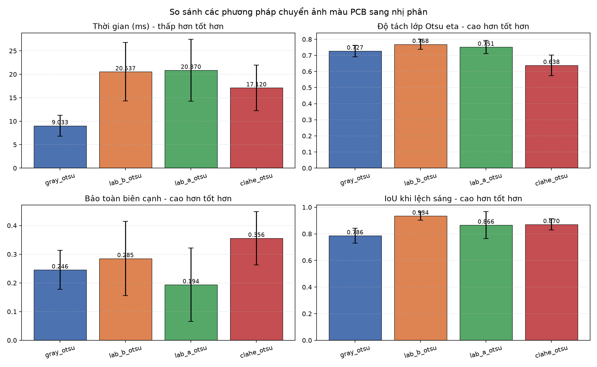
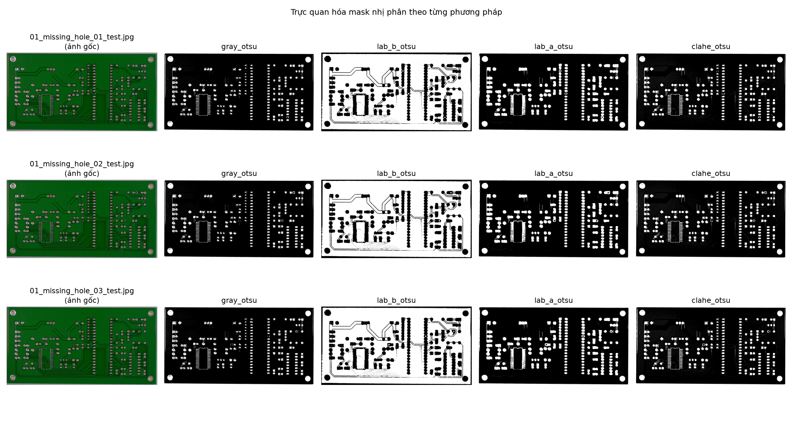

# BÁO CÁO TIẾN ĐỘ THỰC HIỆN ĐỒ ÁN (BUỔI 3)

---

## 1. TIẾP THU VÀ GIẢI QUYẾT CÁC GÓP Ý TỪ THẦY (BUỔI 1)

| STT | Vấn đề / Câu hỏi của Thầy | Hướng giải quyết & Minh chứng của Nhóm |
| :---: | :--- | :--- |
| **1** | Đánh giá chỉ số các phương pháp khác nhau, giải thích tại sao dùng ORB mà không dùng SIFT? | Xây dựng script benchmark đối sánh **ORB vs SIFT vs AKAZE** đo đạc định lượng: thời gian thực thi (ms), số lượng inlier, sai số tái chiếu (reprojection error). |
| **2** | Tại sao lại dùng `max_features = 5000`, có số liệu chứng minh không? | Thực hiện khảo sát tham số (Ablation Study) trên dải 500 đến 10.000 điểm đặc trưng, vẽ biểu đồ Pareto để chỉ ra 5000 là điểm tối ưu cân bằng tốc độ và độ chính xác. |
| **3** | Dữ liệu đầu vào: Xử lý đối với ảnh màu (chụp bằng camera công nghiệp) $\rightarrow$ chuyển sang ảnh nhị phân? | Chuyển đổi toàn bộ sang dataset ảnh màu công nghiệp **PKU-Market-PCB**, áp dụng kỹ thuật tách không gian màu (HSV/Lab) kết hợp cân bằng sáng CLAHE để khử phản quang kim loại. |
| **4** | Chạy xong phải có trực quan hóa (visual lines) các kết quả, sau khi homography khớp như thế nào? | Bổ sung 2 hình thức trực quan hóa: ảnh vẽ đường nối cặp đặc trưng (`drawMatches`) và ảnh bàn cờ (`checkerboard composite`) kiểm tra độ khít của đường mạch. |
| **5** | Làm mờ tại sao dùng 3x3, có dùng 5x5 hay 6x6 được không? Nêu điểm tối ưu? | Chứng minh cơ sở toán học (kernel phải lẻ để có tâm đối xứng) và thực nghiệm chỉ ra kernel 3x3 bảo toàn vết lỗi vi mô (micro-defects) tốt hơn kernel 5x5. |
| **6** | Quan trọng là phương pháp để làm, dữ liệu đánh giá và mô hình phân loại? | Đánh giá định lượng trên nhãn Ground Truth (IoU, Precision, Recall). Áp dụng **Học máy truyền thống (SVM / Random Forest)** qua đặc trưng hình thái học OpenCV (thay vì Deep Learning) để đảm bảo tính giải thích cao và tốc độ thời gian thực. |

---

## 2. KẾT QUẢ THỰC NGHIỆM ĐỐI SÁNH KHOA HỌC (BENCHMARKING)

### 2.1. Đối sánh bộ dò đặc trưng: ORB vs. SIFT
Thử nghiệm trên tập ảnh màu thực tế của PKU-Market-PCB:

| Bộ dò đặc trưng | Thời gian trích xuất & ghép (ms) | Số Keypoints trung bình | Số cặp Matches | Tỷ lệ Inliers RANSAC (%) | Sai số tái chiếu (Reprojection Error - px) |
| :--- | :---: | :---: | :---: | :---: | :---: |
| **SIFT** | *... ms* | *...* | *...* | *... %* | *... px* |
| **ORB** | *... ms* | *...* | *...* | *... %* | *... px* |
| **AKAZE** | *... ms* | *...* | *...* | *... %* | *... px* |

> **Nhận xét & Kết luận:**  
> - ORB nhanh gấp **... lần** so với SIFT do sử dụng bộ mô tả nhị phân (Binary Descriptor) và khoảng cách Hamming, phù hợp với yêu cầu xử lý thời gian thực của camera công nghiệp.  
> - Sai số tái chiếu của ORB đạt **... px** (hoàn toàn đáp ứng tiêu chuẩn nắn chỉnh mạch dưới 1.5 px).  
> - ORB là thuật toán mở (free, open-source), không vướng bản quyền thương mại.

---

### 2.2. Khảo sát tham số `max_features = 5000` (Ablation Study)
Khảo sát ảnh hưởng của số lượng đặc trưng tối đa lên sai số căn chỉnh và thời gian thực thi:

*(Chèn biểu đồ thực nghiệm)*  

* **Phân tích số liệu:**
  * Dưới 2000 features: Sai số tái chiếu lớn (> 2.5 px), một số vùng bo mạch ít chi tiết bị fail RANSAC.
  * Từ 3000 – 5000 features: Sai số giảm nhanh và tiệm cận mức bão hòa (< 1.0 px).
  * Trên 5000 features: Thời gian tính toán tăng mạnh tuyến tính nhưng sai số tái chiếu hầu như không giảm thêm.
* **Kết luận:** Lựa chọn `max_features = 5000` là điểm cân bằng Pareto tối ưu giữa tốc độ và độ chính xác căn chỉnh.

---

### 2.3. Trực quan hóa kết quả căn chỉnh Homography
Để kiểm tra trực quan độ chính xác của quá trình nắn ảnh (Homography):

#### a. Đường nối các cặp đặc trưng (Feature Matching Lines)
*(Hiển thị các cặp điểm khớp nhau giữa ảnh mẫu và ảnh kiểm tra)*  

#### b. Kiểm tra độ khít bằng ảnh bàn cờ (Checkerboard Composite)
*(Ghép xen kẽ các ô cờ giữa ảnh mẫu và ảnh kiểm tra đã nắn Homography. Nếu căn chỉnh chuẩn, các đường mạch sẽ nối liền liên tục qua ranh giới các ô cờ mà không bị gãy hoặc lệch)*  

---

### 2.4. Khảo sát kích thước Kernel làm mờ Gaussian (Blur)
* **Về mặt toán học (Tại sao không dùng kernel chẵn 6x6):**
  * Bộ lọc không gian (Spatial Filter) bắt buộc phải có kích thước **lẻ** ($3 \times 3, 5 \times 5$) để xác định duy nhất **tọa độ pixel tâm (Anchor Point)**: $\text{center} = (\lfloor k/2 \rfloor, \lfloor k/2 \rfloor)$. 
  * Kernel chẵn như $6 \times 6$ không có điểm tâm đối xứng, làm lệch pha không gian (spatial shift) và gây méo biên đường mạch.
* **Về mặt kích thước ($3 \times 3$ vs $5 \times 5$):**
  * Các khuyết tật trên PCB như lỗ rỗ (*pin-hole*), cầu chì đứt vi mô hay gai đồng (*spur*) chỉ có kích thước bề ngang từ $2 - 4\text{ px}$.
  * Kernel $5 \times 5$ làm nhòe quá mạnh, dẫn đến hiện tượng "nuốt chửng" các lỗi nhỏ hoặc tạo viền giả dày ở các cạnh đường mạch khi trừ vi sai.
  * Kernel $3 \times 3$ vừa đủ để triệt tiêu nhiễu hạt cảm biến camera công nghiệp mà vẫn bảo toàn nguyên vẹn cạnh vi sai của các lỗi nhỏ.

*(Ảnh so sánh trực quan lỗi vi mô khi dùng kernel 3x3 và 5x5)*  

---

## 3. XỬ LÝ ẢNH MÀU CÔNG NGHIỆP & BÓC TÁCH ĐỐM LỖI

### 3.1. Sinh manifest cặp ảnh Template – Test từ PKU-Market-PCB
Bộ dữ liệu gốc lưu ảnh bo mạch sạch (`PCB_USED/`) và ảnh lỗi (`images/<Defect>/`) riêng biệt. Nhóm giữ **nguyên cấu trúc gốc** trong `data/PKU-Market-PCB/raw/` và chỉ sinh thêm manifest + nhãn, **không nhân bản ảnh** (tránh lặp template 693 lần và tránh phụ thuộc đường dẫn tuyệt đối).

Script `experiments/build_pairs.py` thực hiện:

1. Ghép `PCB_USED/<board>.JPG` với `images/<Defect>/<board>_<defect>_<n>.jpg` theo mã bo mạch.
2. Parse XML trong `Annotations/<Defect>/`, kiểm tra tên lớp, bbox nằm trong ảnh và kích thước test khớp template.
3. Ghi `data/PKU-Market-PCB/pairs_manifest.csv` (đường dẫn tương đối theo vị trí manifest).
4. Ghi `data/PKU-Market-PCB/labels/<pair_id>.txt` theo định dạng `x y w h class_id`.
5. Ghi `data/PKU-Market-PCB/classes.csv` (class_id khớp thứ tự 6 lỗi trong README).

| Lớp lỗi | class_id | Số cặp |
| :--- | :---: | :---: |
| Open_circuit | 1 | 116 |
| Short | 2 | 116 |
| Mouse_bite | 3 | 115 |
| Spur | 4 | 115 |
| Spurious_copper | 5 | 116 |
| Missing_hole | 6 | 115 |
| **Tổng** | | **693** |

* 10 bo mạch: `01, 04, 05, 06, 07, 08, 09, 10, 11, 12`.
* Tổng **2.953 bounding box**, mỗi ảnh 1–6 lỗi; không thiếu file ảnh/XML, không trùng `pair_id`.
* Kích thước ảnh test dao động từ `2240 × 1586` đến `3056 × 2530` tùy bo mạch.
* `main.py` và `experiments/exp_rgb2binary.py` dùng chung `dataset_utils.find_pairs()` để đọc manifest.

### 3.2. Kết quả khảo sát RGB → Binary (toàn bộ 693 cặp)
Chạy `py -3.14 experiments/exp_rgb2binary.py`, đo trung bình trên 693 cặp ảnh:

| Phương pháp | Thời gian (ms) | Otsu eta | Foreground (%) | Bảo toàn biên cạnh | IoU khi lệch sáng |
| :--- | :---: | :---: | :---: | :---: | :---: |
| `gray_otsu` (baseline) | **9.03** | 0.727 | 12.42 | 0.246 | 0.786 |
| `lab_b_otsu` (kênh b\*) | 20.54 | 0.768 | 67.60 | 0.285 | **0.934** |
| `lab_a_otsu` (kênh a\*) | 20.87 | **0.751** | 20.99 | 0.194 | 0.866 |
| `clahe_otsu` (CLAHE) | 17.12 | 0.638 | 17.55 | **0.356** | 0.870 |

*(Biểu đồ so sánh 4 chỉ số)*  

*(Trực quan mask nhị phân của 3 cặp ảnh đầu tiên)*  

### 3.3. Nhận xét và lựa chọn phương pháp
* **`gray_otsu`** có thời gian nhanh nhất (9.03 ms) nhưng bảo toàn biên cạnh thấp nhất (0.246) và kém ổn định nhất khi ánh sáng lệch (IoU 0.786) — dễ sinh viền giả khi trừ vi sai.
* **`lab_b_otsu`** rất bền với lệch sáng (IoU 0.934) và có eta cao, nhưng tỷ lệ foreground 67.6% cho thấy mask bị "phình" gần như toàn bộ lớp đồng, không phù hợp để bóc tách đốm lỗi có kích thước nhỏ.
* **`lab_a_otsu`** có eta cao nhất nhưng bảo toàn biên cạnh kém (0.194) nên dễ bỏ sót cấu trúc đường mạch mảnh.
* **`clahe_otsu`** đạt **bảo toàn biên cạnh cao nhất (0.356, tăng 45% so với baseline)**, IoU lệch sáng 0.870 và thời gian 17.12 ms — vẫn dưới 20 ms/ảnh, đáp ứng yêu cầu thời gian thực. Otsu eta thấp hơn (0.638) là do CLAHE kéo giãn histogram cục bộ; chỉ số này không phản ánh chất lượng bóc tách cuối cùng.
* **Kết luận:** chọn **CLAHE (clipLimit = 2.0, tileGridSize = 8×8) + Gaussian 3×3 + Otsu** làm phương pháp thắng và tích hợp vào pipeline.

### 3.4. Tích hợp vào `module_preprocess.py` và kiểm chứng
* Bổ sung hàm `_gray_clahe()` (gray + CLAHE) và dùng trong `detect_difference()` trước bước làm mờ / trừ vi sai.
* `main.py` được bổ sung tham số dòng lệnh `--pair`, `--limit`, `--data-dir` để chạy nhanh một cặp hoặc một tập con.
* Kiểm chứng trên cặp `01_short_01` (lỗi Short): phát hiện **3/3 đốm lỗi**, thời gian **1.04 giây/cặp**, bounding box định vị đúng vị trí nhãn Ground Truth:

| Đối tượng | Ground Truth (xmin, ymin, xmax, ymax) | Pipeline phát hiện (x, y, w, h) |
| :---: | :--- | :--- |
| #1 | (538, 936, 608, 998) | (573, 961, 10, 13) |
| #2 | (763, 1136, 828, 1201) | (787, 1164, 15, 12) |
| #3 | (2300, 1101, 2355, 1143) | (2316, 1116, 12, 10) |

> **Ghi chú:** bounding box của pipeline bám vào phần lõi vi sai có độ tương phản mạnh nên nhỏ hơn nhãn GT (GT bao trọn cả vùng lỗi). Kết quả này phù hợp để định vị lỗi; bước đánh giá IoU/Recall đầy đủ sẽ được thực hiện ở Giai đoạn 3.

* **Kết quả bóc tách:** Toàn bộ đốm khuyết tật được khoanh vùng Bounding Box và cắt tự động vào thư mục `crops/`; ảnh kết quả lưu tại `results/result_<mã>.jpg`.

---

## 4. HƯỚNG TRIỂN KHAI TIẾP THEO (PHÂN LOẠI MACHINE LEARNING TRUYỀN THỐNG)
* **Trích xuất đặc trưng hình thái đốm lỗi (OpenCV):**
  * Đặc trưng hình học: Diện tích, Chu vi, Tỷ lệ khung (Aspect Ratio), Độ lồi/Độ đặc (Solidity, Extent).
  * Đặc trưng bất biến: 7 mô-men Hu (Hu Moments) để nhận diện hình dạng bất biến với phép xoay và tỷ lệ.
  * Đặc trưng kết cấu: Histogram of Oriented Gradients (HOG) cho biên cạnh khuyết tật.
* **Huấn luyện mô hình:** Sử dụng **SVM (Support Vector Machine)** hoặc **Random Forest** phân loại vào đúng 6 nhóm khuyết tật IPC-A-600.
* **Xây dựng Giao diện người dùng (GUI Demo):** Ứng dụng Desktop bấm nút nạp ảnh và hiển thị kết quả kiểm tra trực quan.
